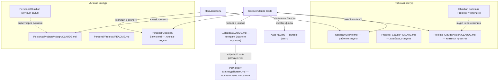

# Регламент взаимодействия (пользователь ⇄ Claude Code)

Цель: всё значимое из обсуждений фиксируется в файлах (не в «памяти сессии»), правила работы едины для любой сессии. Этот файл — полная схема; `~/.claude/CLAUDE.md` (контракт) — краткая выдержка, подгружается в каждую сессию и ссылается сюда.

## Два контура: рабочий и личный

Система разделена на два независимых контура. **Правила в них одинаковые** — различаются только источники:

| | Рабочий | Личный |
|---|---|---|
| Проекты | `~/Documents/Projects_Claude/<slug>/` | `~/Documents/Personal/Projects/<slug>/` |
| Вольт Obsidian | `~/Documents/Obsidian/` (индекс `00 Индекс.md`) | `~/Documents/Personal/Obsidian/` (индекс `00 Индекс.md`) |
| Бэклог задач | `~/Documents/Obsidian/Бэклог.md` | `~/Documents/Personal/Obsidian/Бэклог.md` |
| Дашборд / доска | `Дашборд задач.md`, `Доска.md` | те же файлы в личном вольте |
| Дашборд статусов проектов | `Projects_Claude/README.md` | `Personal/Projects/README.md` |

**Не смешивать:** рабочие задачи — только в рабочем бэклоге, личные — только в личном. Команды бэклога («запиши / актуализируй / разбери») применяются к тому контуру, о котором идёт речь; если непонятно — уточнить.

## Архитектурная схема

Ключевой принцип: **один источник правды на каждый тип информации** (см. таблицу). Obsidian не дублирует содержимое Projects_Claude / Personal — он его отображает и дополняет.

## Что куда пишем

| Что фиксируем | Куда | Кто пишет |
|---|---|---|
| Контекст, решения, шаги проекта | `<контур>/Projects/<slug>/CLAUDE.md` (секции: Что это / Текущее состояние / Решения / Открытые вопросы / Следующие шаги) | Claude по ходу сессии |
| Статус / приоритет / следующий шаг | README-дашборд контура (`Projects_Claude/README.md` или `Personal/Projects/README.md`) | Claude |
| Durable-факты (доступы, хосты, решения, предпочтения) | auto-память (`~/.claude/projects/-Users-macos/memory/`), один файл — один факт, + указатель в `MEMORY.md` | Claude |
| Задачи (бэклог) | `<вольт>/Бэклог.md` — секции по готовности (рабочий или личный вольт) | Claude по командам «запиши/актуализируй/разбери бэклог» |
| Задачи / дедлайны / статусы задач | «Следующие шаги» в `CLAUDE.md` проекта | Claude |
| Правила взаимодействия | этот регламент + выдержка в контракте | Claude + пользователь |
| Карта инфраструктуры (хосты/диски), бэкап-схема | «Регламент инфраструктуры.md» (разделы Карта, Бэкапы; содержит регламенты разработки и бэкапирования) | Claude по фактам + пользователь |

## Структура папки проекта

Стандартные подпапки в `Projects_Claude/<slug>/`:

| Папка | Что лежит |
|---|---|
| `CLAUDE — <имя>.md` (+ симлинк `CLAUDE.md`) | живой контекст проекта |
| `materials/` | входные материалы от пользователя: файлы, фото, документы, выгрузки — в подпапках с говорящими именами; источник и дата — в README подпапки или в CLAUDE.md |
| `artifacts/` | результаты нашей работы: собранные бандлы, сгенерированные файлы |
| `deploy/` | всё для деплоя: systemd-юниты, конфиги, чек-листы |
| прочие (`conf/`, `scripts/` …) | по смыслу проекта |

Правила: материалы не валяются в Downloads/Desktop — сразу кладутся в проект; дубликаты не держим (один источник правды); крупные/бинарные файлы — в эти подпапки, не в корень.

## Правила

1. **Фиксация в день обсуждения.** Значимое из сессии попадает в файл сразу (или в ритуале завершения), не остаётся «на потом».
2. **Ритуал завершения сессии** (выполняется Claude без напоминаний):
   1) обновить CLAUDE.md проекта (Текущее состояние, Решения, Следующие шаги);
   2) durable-факты — в auto-память (+ MEMORY.md);
   3) изменился статус/приоритет — дашборд README;
   4) незакрытые хвосты — явно в «Следующие шаги».
3. **Новый проект** (процедура): 1) папка `Projects_Claude/<slug>/` с реальным файлом `CLAUDE — <имя>.md` + симлинк `CLAUDE.md`; 2) строка в README-дашборд и в `Obsidian/00 Индекс.md`.
4. **Серверы**: у Claude нет доступа — он даёт готовые команды, пользователь выполняет (терминал или `!` в Claude Code), Claude продолжает сам после шага пользователя.
5. **Изменение правил**: согласуется с пользователем → вносится в этот регламент и в контракт.
6. **Инфраструктурная задача** (серверы/хосты/бэкапы/диски/шары/Zabbix/сеть): сначала прочитать «Регламент инфраструктуры.md» (Карта + Бэкапы), сверить факты командами, расхождения — в регламент; имена в отчётах — по канону этого регламента.
7. **Стиль**: русский, кратко, факты прежде выводов; непроверенное помечать как непроверенное.

## Кто чем владеет

- **Пользователь**: серверы и их конфигурация, UI Obsidian, конечные решения.
- **Claude**: файлы проектов/памяти/бэклога, дашборд, инструкции и команды для пользователя.

## Известные ограничения

- Edit по симлинку `CLAUDE.md` отказывает — редактировать реальный файл `CLAUDE — <имя>.md`.
